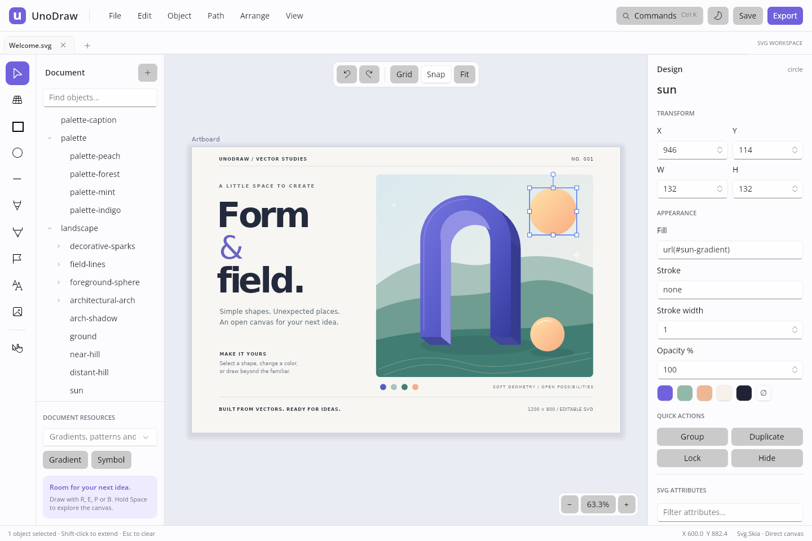
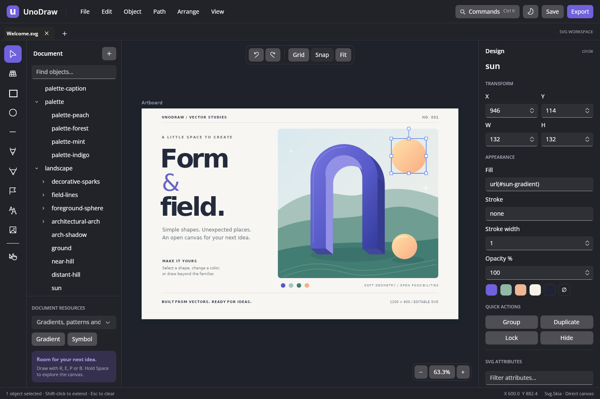

# UnoDraw

UnoDraw is the Uno Platform successor to the AvalonDraw sample. It edits SVG documents through the repository's SVG DOM and renders them with Svg.Skia. The application lives in [`samples/UnoDraw`](../samples/UnoDraw); its reusable Uno workspace lives in [`src/Svg.Editor.Skia.Uno`](../src/Svg.Editor.Skia.Uno).

The application migration does not remove the reusable Avalonia editor packages. Existing consumers can continue using `Svg.Editor.Avalonia` and `Svg.Editor.Skia.Avalonia`.

## Workspace preview

These native Linux captures show the welcome document at the earlier desktop migration milestone. The current workspace also exposes the authoring and print commands documented below.

| Light theme | Dark theme |
| --- | --- |
|  |  |

## Build and run

Use the .NET 10 SDK selected by the repository's `global.json`. The default target is `net10.0-desktop`, with Windows, macOS and Linux hosts. Browser, Android and iOS targets are opt-in through `UnoDrawTargetFrameworks`; a default desktop solution build does not require their workloads. The target configuration is in [`UnoDraw.csproj`](../samples/UnoDraw/UnoDraw.csproj).

### Desktop

```sh
git submodule update --init --recursive
dotnet restore samples/UnoDraw/UnoDraw.csproj
dotnet build samples/UnoDraw/UnoDraw.csproj -f net10.0-desktop -c Release
dotnet run --project samples/UnoDraw/UnoDraw.csproj -f net10.0-desktop
```

To open an existing document on launch:

```sh
dotnet run --project samples/UnoDraw/UnoDraw.csproj -f net10.0-desktop -- /path/to/drawing.svg
```

The initial document is [`Welcome.svg`](../samples/UnoDraw/Assets/Welcome.svg), an editable 1200 × 800 composition with gradients, text, clipping, symbol instances and grouped geometry. It uses no external images or font downloads. The existing tiger and camera samples remain available alongside it.

For Linux host dependencies and graphics configuration, follow the [Uno Skia Desktop documentation](https://platform.uno/docs/articles/features/using-skia-desktop.html). A working graphical desktop is required to launch the app; command and geometry tests run without a window.

### Browser and mobile targets

Each command below selects one target explicitly. Install the corresponding workload with the SDK selected by this repository. The [UnoDraw workflow](../.github/workflows/unodraw.yml) contains the matching package jobs; their existence does not imply a completed device or browser test. See the validation record for results at a particular commit.

| Target | Framework | Host requirements and output |
| --- | --- | --- |
| Desktop | `net10.0-desktop` | Windows, macOS or Linux host; direct Uno Skia canvas. |
| Browser | `net10.0-browserwasm` | `wasm-tools`; published WebAssembly application. The project defaults to interpreter execution and disables trimming because SVG element/attribute discovery uses reflection. |
| Android | `net10.0-android` | Android workload, Android SDK and JDK; APK output, minimum Android API 23. |
| iOS | `net10.0-ios` | macOS, compatible Xcode and iOS workload; minimum iOS 15. Simulator builds do not require distribution signing. |

Publish browser assets:

```sh
dotnet workload install wasm-tools --skip-manifest-update
dotnet publish samples/UnoDraw/UnoDraw.csproj -f net10.0-browserwasm -p:UnoDrawTargetFrameworks=net10.0-browserwasm -c Release -o artifacts/unodraw-browser
```

Serve the published WebAssembly web assets over HTTP or HTTPS. The browser CI job additionally requests `-p:WasmShellMonoRuntimeExecutionMode=InterpreterAndAOT`; the default project setting remains `Interpreter` so local development does not require an AOT publish. AOT enables the required linker pipeline while assigning the `copy` action to every managed assembly, preserving SVG reflection metadata and JSON recovery serialization. Browser builds enable IndexedDB-backed filesystem persistence for recovery storage. File pickers and saves use Uno storage providers, including completion of provider-managed downloads, rather than assuming every selected file exposes a writable native path.

Release browser packages omit native DWARF debug information before AOT/native optimization to reduce build memory pressure. This does not trim managed assemblies or SVG reflection metadata. Use `-p:WasmNativeDebugSymbols=true` when native WebAssembly debugging is needed and the build host has sufficient memory. CI also limits Binaryen to one worker and publishes with serial MSBuild execution and no shared C# compiler process; AOT and the optimization level remain enabled.

Build a local Android APK after installing the Android SDK and JDK (CI uses JDK 21):

```sh
dotnet workload install android --skip-manifest-update
dotnet build samples/UnoDraw/UnoDraw.csproj -t:InstallAndroidDependencies -f net10.0-android -p:UnoDrawTargetFrameworks=net10.0-android -p:AndroidSdkDirectory="$ANDROID_HOME" -p:AcceptAndroidSdkLicenses=true
dotnet publish samples/UnoDraw/UnoDraw.csproj -f net10.0-android -p:UnoDrawTargetFrameworks=net10.0-android -r android-arm64 -c Release -p:AndroidKeyStore=false
```

The dependency command accepts the Android SDK licenses. `AndroidKeyStore=false` produces a local/test package; configure your own signing when preparing distribution packages.

Build the iOS simulator application on an Apple Silicon Mac:

```sh
dotnet workload install ios --skip-manifest-update
dotnet build samples/UnoDraw/UnoDraw.csproj -f net10.0-ios -p:UnoDrawTargetFrameworks=net10.0-ios -c Release -p:RuntimeIdentifier=iossimulator-arm64 -p:EnableCodeSigning=false -p:UseInterpreter=true -p:MtouchUseLlvm=false
```

The iOS CI job pins .NET SDK/workload 10.0.401 with Xcode 26.6 on macOS 26; keep the workload and Xcode versions compatible when building locally. This simulator command uses the interpreter to avoid AOT-compiling the entire preserved SVG dependency graph; device Release builds retain the normal AOT configuration. The iOS head supplies native folder, format, file-name and overwrite prompts because Uno 6.5 does not provide a default save picker. Its application delegate obtains background time to finish a recovery checkpoint when the app leaves the foreground.

Use `iossimulator-x64` for an Intel simulator host. Physical-device and distribution builds need the corresponding runtime identifier and signing configuration. These targets share the same workspace and SVG engine; file access, fonts, GPU backends and pointer behavior still depend on the host. Desktop startup paths are a desktop feature; the embedded welcome SVG supplies the initial document on all targets.

## Architecture

| Component | Responsibility |
| --- | --- |
| `Svg.Editor.Core` | Document session, selected IDs, outline models, settings and undo/redo snapshots. |
| `Svg.Editor.Svg` | SVG document services, resource-path rebasing, property conversion, tools, paints, layers, resources and appearance models. |
| `Svg.Editor.Skia` | `SvgEditorController`, geometry and hierarchy operations, retained scene hit testing, viewport, text composition, animation authoring, mesh/brush services and print production services. |
| `Svg.Editor.Skia.Uno` | Uno workspace, `SvgEditorCanvas`, pointer routing, responsive panels, authoring dialogs, timeline, Print Studio and document workflow. |
| `Svg.Skia` and its existing dependencies | SVG parsing, resource loading, scene compilation, text shaping, paint/filter/mask interpretation and Skia picture creation. |
| `samples/UnoDraw` | Desktop and opt-in browser/mobile startup, branding, platform manifests and sample assets. |

### Document ownership

`SvgDocument` is the editable source of truth. Commands mutate the DOM, retain its resource definitions and serialize native SVG for saving and history. An SVG save does not flatten the drawing into a rendered path collection or bitmap. Serialization can normalize XML formatting; it is not a byte-for-byte source preservation mechanism.

`SvgEditorController` owns the active renderer and exposes the retained picture and scene nodes for drawing and selection. The controller does not depend on Uno or Avalonia. This keeps geometry, selection, transaction and document tests independent of the windowing framework.

The public controller supports explicit transactions:

```csharp
using var editor = new SvgEditorController();
editor.LoadSvg(svgSource);
editor.Select(editor.Document!.GetElementById<SvgRectangle>("shape"));

editor.BeginEdit("Move shape");
editor.MoveSelection(24, 12);
editor.CommitEdit();

editor.Undo();
var editableSvg = editor.GetSvg();
```

Use `CancelEdit()` when a gesture is interrupted. `Execute(label, action)` supplies an atomic mutation boundary and restores the prior document if the mutation fails. Selection changes do not add undo entries. Dirty state is measured against the last saved XML checkpoint, so undoing back to that checkpoint clears the modified indicator.

`SvgResourcePathService.Rebase(xml, originalDocumentUri, targetDocumentUri)` preserves linked resource locations when saving into another directory. It rewrites relative `href`/`xlink:href` references, CSS `url()` values and stylesheet imports, including `xml-stylesheet` processing instructions. Nested relative `xml:base` values are rebased before their descendants are visited. Absolute URLs, embedded data URIs, and local `#fragment` references retain their spelling. CSS comments and ordinary quoted text are preserved. The helper uses absolute document URIs, does not download or copy resources, and disables external XML entity resolution. Referenced external stylesheets continue resolving their own relative resources from the same stylesheet location.

After successfully writing a captured SVG snapshot, hosts call `SvgEditorController.AcceptSave(savedXml, fileName)`. Saving to a new location updates the resource context of the current document and its undo/redo snapshots without adding a separate editing operation. The checkpoint represents the snapshot actually written; edits made while an asynchronous save was in progress remain dirty.

### Canvas and performance

`SvgEditorCanvas` derives from Uno's `SKCanvasElement`. It draws into the Skia surface already used by Uno through `SKSvg.Draw`, replaying the retained picture and current animation layers. It does not rasterize an intermediate image on every frame.

The host selects the graphics backend and may fall back to software. Using `SKCanvasElement` enables direct accelerated drawing when the host provides it; it does not prove that a particular machine is using a GPU. The workspace deliberately identifies the rendering path as a direct canvas rather than displaying an unconditional hardware status claim.

`SvgEditorViewport` keeps camera state separate from document state. Pan, zoom, fitting, selection and overlays do not serialize the SVG or recreate its retained picture. Zoom is anchored to the cursor and bounded between 1% and 12,800%; calculations use double precision before conversion to the Skia transform. The picture cache is invalidated by document edits.

Two-finger navigation applies the moving midpoint and scale together. A second touch cancels an unfinished drawing preview; remaining contacts stay in navigation mode until all fingers lift. Adding or removing a third contact rebases the active pair, and capture loss cancels the gesture. Touch contacts cannot interrupt an active stylus or mouse stroke.

Move, resize and rotate previews record a native picture of the selected scene once when a gesture begins. Pointer movement transforms and replays this cached picture with approximately 65% opacity over the original artwork. The snapshot retains paint order and ancestor transforms, clipping, masks, filters and opacity. It is released when the gesture commits, is cancelled, loses capture or the canvas unloads.

Document transactions currently use XML snapshots. They coalesce a gesture into one history operation, but this is not a persistent immutable document model or a fully incremental renderer. Large document serialization, complex filters and expensive font/resource loads remain performance considerations. Retained-scene mutation APIs in Svg.Skia are available for future measured optimizations.

### Geometry correctness

Selection geometry comes from Svg.Skia's retained scene. Movement and affine transforms are expressed in picture coordinates and mapped through the selected object's parent transform. A child inside a scaled or rotated group therefore follows the same world-space movement as a root object. Selecting both an ancestor and its descendant does not apply a transform twice.

Boolean operations transform the input paths into a common destination coordinate system before invoking Skia path operations. Grouping is restricted to a common parent. Ungrouping ordinary groups carries inherited presentation values and transforms to the children. Groups with compositing opacity, masks, clips or filters are rejected for ungrouping because distributing those effects across children would change the rendered result.

## Workspace and controls

The workspace uses document tabs, a tool rail, a searchable document outline, a contextual design inspector and command search. A compact menu replaces the full menu bar below 1,100 pixels. The outline docks at widths of at least 1,100 pixels and the inspector at widths of at least 760 pixels. **View → Layers and objects** and **View → Object inspector** reopen these controls in flyouts when they are not docked. Focus-canvas mode hides both panels. Feature dialogs use stacked controls or scrollable content at narrow widths; the timeline ruler can scroll horizontally. Light and dark themes share the same workspace.

Open `.svg` or compressed `.svgz` files from the file picker, drag files onto the workspace, or supply a path at startup. Raster images placed into a document are embedded as data URIs. Choose the format explicitly in the export dialog. Export supports editable SVG, PNG, JPEG, WebP, PDF and XPS through the existing Svg.Skia export APIs. Selected-object export includes SVG resources needed by the copied content. The export scale is limited to 0.01–16× and oversized raster exports are rejected before allocation.

| Action | Keyboard or pointer control |
| --- | --- |
| New / open / save | `Ctrl+N`, `Ctrl+O`, `Ctrl+S`; `Ctrl+Shift+S` saves to a new destination. |
| Search every command | `Ctrl+K`. |
| Print and page setup | `Ctrl+P`. |
| Save a compressed SVG | **File → Save compressed SVG…** (also available with browser downloads). |
| Select / edit nodes | `V` / `A`. |
| Rectangle / ellipse / circle / line | `R` / `E` / `C` / `L`. |
| Bézier pen / quadratic pen / pencil | `P` / `Q` / `B`. |
| Polygon / polyline / text | `G` / `O` / `T`. |
| Add to selection | Shift-click or Control-click. |
| Pan | Hold Space and drag, middle-button drag, or select the hand tool with `H`. |
| Zoom / horizontal pan | Mouse wheel / Shift-wheel; two-finger pinch also changes the viewport. |
| Fit artboard / fit selection | `Shift+1` / `Shift+2`. |
| Actual size | `Ctrl+0`. |
| Nudge / larger nudge | Arrow keys / Shift+arrow keys. |
| Duplicate / group / ungroup | `Ctrl+D` / `Ctrl+G` / `Ctrl+Shift+G`. |
| Undo / redo | `Ctrl+Z` / `Ctrl+Shift+Z` or `Ctrl+Y`. |
| Finish a pen path | Enter, right-click or double-click; click the first node to close it. |
| Cancel a provisional gesture | Escape. |
| Focus the canvas / shortcut help | Tab / `F1`. |

Pen clicks add anchors; dragging an anchor while drawing a cubic path establishes its tangent. Shift constrains movement, shape aspect ratio, line direction and rotation as appropriate. Node editing operates on a provisional clone so selecting a path does not normalize or modify the saved SVG. The node tool also edits native polygon and polyline vertices without converting them to paths: double-click an edge to insert a vertex, or delete a selected vertex while retaining at least three polygon vertices or two polyline vertices. Move, resize and rotate gestures show a translucent full-color preview with selection handles and commit the actual document transform on release.

### Variable width strokes, meshes and brushes

**Path → Variable width stroke** converts an open or closed path into an ordinary filled SVG outline. The dialog provides a native live preview, taper/brush presets, editable width points, and flat, round or square ends. Widths interpolate along arc length in the path's local SVG coordinates. Closed contours preserve their interior holes and require equal first and last widths at the seam; caps apply to open contours. Multiple contours are supported.

The original centerline and width profile remain in `data-unodraw-*` attributes so the dialog can adjust the profile later. Editing generated outline nodes invalidates this association; the service rejects reapplication rather than replacing those edits. Applying an independent width profile detaches a brush-library link. The operation retains the path ID, transforms and effects and creates one undo entry. See [`SvgVariableStrokeService`](../src/Svg.Editor.Skia/SvgVariableStrokeService.cs).

**Object → Gradient mesh** creates a mesh or reopens the selected mesh group. Drag nodes and their horizontal/vertical tangent handles in the preview, or enter coordinates, tangent derivatives, color and opacity numerically. Rows and columns define a rectangular network of cubic Coons patches. Each patch interpolates its corner colors in premultiplied RGBA. Shared boundaries use the same node derivatives; this model is a rectangular Coons network, with bilinear color interpolation within each patch.

[`SvgGradientMeshService`](../src/Svg.Editor.Skia/SvgGradientMeshService.cs) tessellates the actual curved patches into ordinary SVG polygons and stores the editable control network separately. This is a portable vector approximation with selectable quality, not a dependency on native SVG mesh-paint support. More subdivisions improve color and boundary smoothness while increasing document size. The service permits 2–16 nodes in each direction and at most 32,768 triangles. Generated-artwork fingerprints protect independent polygon edits. The native preview uses reduced tessellation while dragging and restores full quality on release.

**Path → Brush library** authors reusable width-profile, repeating-pattern and scatter brushes. Choose a document preset or create one, set its width and color, and edit its width multipliers or SVG stamp path. Pattern/scatter controls include spacing, rotation, tangent following, scatter amount and deterministic seed. A selected path can supply the stamp geometry. Each stamp is a single-color vector path; multi-color resource-backed artwork is not a brush-stamp format in this implementation.

Save a brush definition in the SVG, apply it to selected paths, or update all artwork linked to that definition. The dialog supports duplication, removal, and import/export of `.unodraw-brushes` XML libraries. Removing a definition leaves its rendered artwork and retained settings available. Linked updates are staged before mutation, reject locked or independently edited outlines, and form an atomic undo operation. Generated results are ordinary filled SVG paths; resource links use `url(#id)` so copy/paste can remap brush identities together with artwork. Each stroke is limited to 4,096 stamps and 256 contours. See [`SvgBrushLibraryService`](../src/Svg.Editor.Skia/SvgBrushLibraryService.cs).

### Shared swatches and named inks

**Object → Document swatches** creates or edits reusable solid-color SVG gradient resources. A swatch can remain in the document palette or be linked to selection fill or stroke. Editing a shared swatch recolors all linked artwork. The dialog preserves existing resource and stop IDs and excludes opacity gradients from solid-color editing.

An optional **Spot ink name** assigns `data-unodraw-spot-name` to the swatch. The SVG still displays its alternate RGB color in ordinary viewers. Named-ink export uses the explicit separation workflow below; adding an ink name does not cause ordinary PDF export to create a spot color space.

### Layers and hierarchy

The outline supports multiple selection and drag/reorder/reparent operations. Clear outline search before dragging so the destination order is unambiguous. **Object → Move to layer** provides a destination group or layer, front/back placement and a **Keep position on the canvas** option. **Move out of group** moves a selection from one shared parent into the containing parent.

[`SvgEditorController.Hierarchy`](../src/Svg.Editor.Skia/SvgEditorController.Hierarchy.cs) retains object identity, local resource references and relative painter order. It compensates for parent transforms when preserving world position, materializes inherited presentation before detachment, and reduces ancestor/descendant selections to their outermost branches. Cycles, invalid SVG parent/child combinations, locked branches and singular destination transforms are rejected before mutation. New destination-group compositing intentionally applies to the moved children; moving artwork between groups with different opacity, masks, clips or filters can therefore change its appearance. One completed move creates one undo operation.

### Paragraphs and linked text frames

**Edit → Paragraphs and linked text frames** creates a text story or reopens the story containing the selected generated text. Select a range in the story editor to assign font family, size, weight, italic, paint, letter spacing and OpenType features. Set default typography separately from explicit rich-text ranges. Paragraph settings include start/center/end/justified alignment, line height, spacing, first-line and side indents, and right-to-left direction; settings can target the current paragraph or all paragraphs.

Frames flow in list order and then column order. Add or remove linked frames, reorder them, edit their position, dimensions, padding, columns and gaps, or split the chain before a selected frame to create independent stories. Live preview reports unplaced text and horizontal overflow. The full source story survives when not all content fits; Print Studio preflight reports overflow as an error.

The reusable [`SvgTextLayoutService`](../src/Svg.Editor.Skia/SvgTextLayoutService.cs) measures text through the renderer asset loader, using HarfBuzz advances and available font fallback. It preserves grapheme boundaries and uses greedy line breaking with Unicode whitespace, CJK and explicit hyphen opportunities. It does not provide dictionary hyphenation, arbitrary-shaped text frames, or a full paragraph optimization engine. Layout supports up to 200,000 characters, 128 rectangular frames and 20,000 lines.

[`SvgTextStoryService`](../src/Svg.Editor.Skia/SvgTextStoryService.cs) emits standard SVG `text`/`tspan` elements, with story, frame-chain and rich-range metadata retained on the enclosing group. Visible text stays native SVG text. Fonts remain an environment/resource dependency; the story format does not automatically package them. Direct edits to generated text are detected before reflow, protecting those edits from being overwritten. Applying a story or splitting it uses atomic document history.

### Animation timeline

**View → Animation timeline** reads and authors standard SVG `animate`, `animateTransform`, `animateMotion` and `set` tracks through [`SvgTimelineService`](../src/Svg.Editor.Skia/SvgTimelineService.cs). Add, duplicate or delete tracks; select a target; edit clock or SVG begin expressions, duration, repeats, final-value holding, additive behavior and accumulation. Values can use keyframes, from/to, from/by, to-only or by-only forms. Motion tracks support inline SVG path data or a local path reference, normalized distances and rotation.

The timeline provides a native preview, play/pause, looping, a numeric playhead and a ruler. Click to scrub and drag keyframe diamonds to adjust timing. Keys expose values and cubic Bézier easing, with linear/ease presets; interpolation supports the SVG discrete, linear, paced and spline modes. Key positions are unique normalized times, with a 4,096-key limit per track. Evaluation and event-timing support remain those of the shared `Svg.Animation` engine; the dialog is not a JavaScript debugger or a browser DOM authoring environment.

Playback schedules one frame at a time and yields to input before rearming the timer. The numeric playhead updates at 10 Hz independently of the preview and ruler, avoiding a complete form layout on every rendered frame. Pause, close and unload guards prevent queued callbacks from restarting playback.

Edits occur in a draft controller with its own undo/redo history. **Update preview** evaluates the draft. **Save timeline** applies the draft to the source as one undoable document change and retains the playhead. Cancelling leaves the source unchanged. A document revision check rejects stale saves. Standard animation elements are stored directly in SVG, so reopening does not require a private timeline file. Saving the document or using Save As also preserves the active playhead without baking its animated values into the source geometry.

**Object → Bake current animation frame** evaluates the current playhead, writes its static values into an editable SVG snapshot, and removes SVG animation elements in one undoable operation. Ordinary image/PDF/XPS exports and Print Studio capture the selected timeline position, including cached animation layers. Bake the frame before named-ink separation, which requires static artwork. The bake operation uses the SVG animation evaluator; it does not convert arbitrary scripts into static artwork.

Editing shortcuts are suppressed while a text-entry control has focus. The workspace also accepts the platform Windows/Command modifier where Uno reports it for the corresponding Control shortcuts.

## Print production

**File → Print and page setup** opens Print Studio; **File → Preflight document** opens the issue list independently. Print Studio generates files for printing. It does not submit jobs to an operating-system printer queue.

### Pages and output choices

Set trim dimensions in millimeters, inner margin, bleed, scale, tile overlap, crop marks and registration marks. Presets include A4, A3, Letter and A5. Placement supports fit to page, actual size/custom scale, and tiling across pages. Actual size maps SVG pixels using 96 pixels per inch and PDF points using 72 points per inch. Page previews show each tile, and PDF output includes media, trim and bleed boxes. Layout is limited to 256 pages. Page settings are retained in `data-unodraw-print` as an undoable document edit.

| Output | Representation and color behavior |
| --- | --- |
| RGB PDF | Replays the Svg.Skia picture to the native Skia PDF backend, retaining supported vector geometry and text. Existing renderer/backend limits still apply to effects and font embedding. |
| CMYK PDF | Flattens each page against white at the selected resolution, converts pixels to four-channel CMYK, and writes raster PDF pages. A supplied supported ICC profile is embedded as the image color space and output intent. Without a profile, output uses generic arithmetic CMYK. |
| Process separation ZIP | Contains grayscale Cyan, Magenta, Yellow and Black PNG plates per page, DPI metadata, `print-job.xml`, the captured `artwork.svg` when supplied by the workspace, and the output ICC profile when selected. |
| Named-ink separation ZIP | Adds a grayscale plate for each named ink and page, with its Unicode name, originating resource IDs and alternate RGB color in the manifest. Process plates have named paint knocked out. |

The raster resolution range is 36–2,400 dpi, subject to a 40-million-pixel page limit and 160-million-pixel job limit. Named-ink packages apply a further aggregate plate limit and allow at most 32 named inks. A requested resolution can therefore exceed the safe allocation limit for a large page or tiled job and is rejected before export. Grayscale plate convention is black for full ink and white for no ink; the package is continuous-tone coverage, not screened halftone data.

CMYK PDF output does not retain editable vectors/text, and named plates are not embedded as PDF `/Separation` color spaces. If the document has named inks, the PDF workflow requires explicitly selecting **Convert named inks to process colors in PDF**. Choose **Export separations** to retain independent named plates. This workflow does not claim PDF/X conformance, trapping, overprint simulation, press proofing or complete RIP behavior.

### ICC conversion and preflight

[`SvgIccCmykProfile`](../src/Svg.Editor.Skia/SvgIccCmykProfile.cs) accepts CMYK printer output profiles with Lab or XYZ connection spaces and ICC.1 LUT8 (`mft1`), LUT16 (`mft2`) or B-to-A (`mBA `) transforms. Conversion includes sampled/parametric curves and tetrahedral lookup-table interpolation. Input colors are treated as sRGB and adapted to the D50 connection space. The UI requests relative colorimetric output (`B2A1`), with `B2A0` fallback when that transform is absent. Unsupported profiles are rejected; this is a defined ICC transform subset, not universal profile support.

Loading a profile disables the generic black-generation and total-ink-limit controls because the profile supplies the separation. Without a profile, those controls adjust the arithmetic conversion but do not characterize a particular printer or paper. The ICC selection belongs to the current Print Studio session; exported profiled packages carry the profile bytes, while SVG page-setup metadata stores numeric settings rather than the profile.

[`SvgPreflightService`](../src/Svg.Editor.Skia/SvgPreflightService.cs) reports duplicate IDs, missing local references, missing/linked files, animation/dynamic content, text overflow, font substitution, and low effective resolution for decodable embedded raster images. It also identifies unprofiled CMYK and flattening. Issues with object IDs can select and fit the affected object. This is an advisory document inspection: it does not establish press conformance or prove that every external resource and font will be available at the destination. Named-ink export has additional blocking checks described below.

### Named ink semantics and limits

[`SvgSpotSeparationService`](../src/Svg.Editor.Skia/SvgSpotSeparationService.cs) recognizes named linear/radial gradient swatches whose stops share one alternate RGB color. Stop alpha/opacity may vary to represent tints. Resources may share an ink name only when their alternate RGB colors agree. Derived gradient references can retain the named ink while changing opacity and geometry.

Separation uses normal source-over knockout compositing. For the process derivative, named paints become white with their original alpha. For a named plate, that ink becomes black and other paints become white with their original alpha, so ordinary opaque artwork knocks out an underlying ink and translucent artwork creates partial knockout. Masks, clips, transforms, inherited paint and group opacity remain in SVG. Mask resources are not recolored, including paint resources shared by a mask and artwork. Author CSS overrides are resolved on a document snapshot, and the shared SVG serializer preserves color alpha independently from paint opacity across save/reopen cycles. The original source is retained untouched.

Active images, `use` instances, pattern/custom paints, path markers, color-changing filters, non-normal blend modes, and animation/dynamic content are rejected for named-ink separation rather than silently assigning their pixels to an ink. Expand supported instances/markers to ordinary artwork, replace unsupported paints, or bake the desired frame before retrying. These checks concern named-ink packages; ordinary RGB or explicitly process-converted export continues using the repository renderer's supported SVG features. Spot ink metadata alone does not add support for mixed process/spot raster images, arbitrary filter separation, overprinting or trapping.

## Portable SVG and authoring metadata

Native SVG remains the editable source of truth. Saving a document preserves supported elements and resource definitions; choosing a generated outline, mesh or text-story command deliberately adds portable geometry/text together with higher-level edit data.

| Feature | Standard SVG representation | Retained authoring data |
| --- | --- | --- |
| Width profile | Filled `path`. | Original centerline, width points, cap and generated-geometry fingerprint. |
| Brush artwork | Filled stamp/outline `path`; reusable definitions in `defs`. | Definition XML, source centerline, applied settings, original opacity and remappable `url(#id)` library link. |
| Gradient mesh | Group of colored triangular `polygon` elements. | Coons control network, node colors, subdivision quality and generated-artwork fingerprint. |
| Linked text story | Groups containing positioned `text` and `tspan` elements. | Full story including overflow, rich ranges, paragraph overrides, frame chain and layout fingerprint. |
| Timeline | Standard SVG animation elements and resource references. | Animation state lives in those SVG elements; the editor draft is temporary. |
| Swatches and print | SVG gradient references for paints; normal document content for artwork. | Optional named-ink identity and serialized page setup. |

Metadata is carried in `data-unodraw-*` attributes, with versioned XML payloads where needed. An SVG viewer can render generated geometry/text without interpreting this metadata. An optimizer that removes the attributes can keep the visible artwork while discarding UnoDraw's re-edit/reflow state, including text that did not fit its frames. Direct edits to generated content can also invalidate a fingerprint; the authoring service rejects regeneration when it would overwrite those edits. Keep the authoring SVG when exporting flattened images or print packages.

## Feature coverage and current boundaries

Rendering a construct, retaining it in the document, editing attributes and providing a dedicated visual authoring surface are different capabilities. UnoDraw continues using the repository's full Svg.Skia pipeline for supported paths, shapes, text, gradients, patterns, images, clipping, masks, filters, symbols, CSS and resource references. The underlying SVG specification coverage remains documented in the [repository guide](../README.md) and renderer tests.

| Area | Implemented authoring surface | Current boundary |
| --- | --- | --- |
| Documents and history | Tabs, SVG/SVGZ open/save, recovery, source/attribute editing, atomic undo/redo and save checkpoints. | Serialization normalizes XML; history uses document snapshots. |
| Drawing and geometry | Shape/path tools, freehand drawing, pen tangents, native polygon/polyline vertex editing, node operations, boolean paths, offsets, blends, simplification and transforms. | Operations use the exposed geometry services; no general multi-region path division command is claimed. |
| Hierarchy | Multiple outline selection, drag/reorder/reparent, move to layer/out of group, locking and visibility. | SVG content categories, locks and transforms are validated; destination compositing applies. |
| Paint resources | Gradient and pattern creation, shared swatches, symbols, document CSS and attribute editing. | These commands do not constitute a complete visual editor for every SVG paint/resource attribute. |
| Advanced paint | Editable Coons meshes, width-profile/repeating/scatter brush libraries, open/closed variable-width outlines and square caps. | Mesh output is tessellated vector geometry; brush stamps are single-color SVG paths. |
| Typography | Rich-text ranges, paragraph formatting, rectangular linked frames/columns, chain splitting and overflow reporting. | Greedy line composition; no arbitrary-shaped frames or dictionary hyphenation. Fonts remain dependencies. |
| Animation | Track/keyframe authoring, easing, draft preview/history, native SVG save and static-frame bake. | Evaluation follows the shared animation engine; arbitrary scripts and browser DOM interaction are not timeline authoring features. |
| Effects | Existing renderer effects, clipping, drop-shadow command, source and attribute editing. | No complete visual filter graph or generalized effect builder. |
| Print | Physical pages/tiling/marks, PDF page boxes, preflight, RGB vector PDF, profiled flattened CMYK and process/named-ink packages. | Explicit ICC/compositing subsets; no vector CMYK, spot PDF color spaces, PDF/X certification or overprint/trapping engine. |
| Platforms and layout | Desktop default; browser/Android/iOS target configuration, compact menus, panel flyouts and narrow dialogs. | Package/build checks and physical-device/GPU validation are separate records. |

The reusable Avalonia packages remain available. The earlier workspace is useful as a reference for additional interaction design, but its legacy mesh surface and operation names are not evidence of equivalent implemented rendering or geometry. In particular, the legacy service operation called “Divide” delegates to reverse difference.

## Validation

The [UnoDraw workflow](../.github/workflows/unodraw.yml) defines desktop build and framework-independent editor test jobs on Linux, Windows and macOS, plus separate WebAssembly publish, Android APK and iOS simulator package jobs. Each optional platform job installs its own workload; the desktop jobs do not require them. The Linux desktop startup check launches the built app with the welcome SVG under Xvfb, catches early exits and native loading failures, and uploads its log. It uses software graphics and does not exercise physical GPU hardware. A configured CI job is not a passing validation result; record the run and commit below after completion.

```sh
dotnet test tests/Svg.Editor.Skia.UnitTests/Svg.Editor.Skia.UnitTests.csproj -c Release
dotnet test tests/Svg.Editor.Svg.UnitTests/Svg.Editor.Svg.UnitTests.csproj -c Release
```

Controller regressions cover transformed-parent movement, ancestor/descendant selection, retained-picture stability during selection, atomic rollback, dirty-state checkpoints, Save As history, and preservation of compositing references when converting, copying or clipping geometry. Viewport tests cover coordinate conversion, anchored zoom and invalid camera input. Resource-path tests verify that Save As references resolve to the same absolute resource across directories, file volumes and web origins, including nested XML bases, CSS escapes, stylesheet links and local fragments. Vertex tests preserve native polygon/polyline identity, presentation, metadata and point units; they exercise geometry limits, invalid input and undo under parent transforms. Retained-preview tests verify compositing and snapshot lifetime; path tests exercise node deletion and smooth shorthand segments. Variable-width stroke tests cover caps, tapers, curves, open/closed contours, geometry limits, locks, one-step undo, metadata reopening, stale-node rejection and raster rendering after an SVG round trip. Completion regressions add hierarchy identity/world-transform preservation; rich-text shaping, frame flow, splitting and overflow; timeline track round trips and bake; mesh boundaries, color interpolation and stale edits; brush library updates, resource remapping and deterministic stamps; print page boxes, ICC pipelines and plate packaging; and named-ink knockout with masks, CSS and saved/reopened opacity. Existing service tests continue covering the underlying geometry and SVG editor helpers.

Repository-wide validation remains:

```sh
dotnet format Svg.Skia.slnx --no-restore
dotnet build Svg.Skia.slnx -c Release
dotnet test Svg.Skia.slnx -c Release
```

### Completion validation record

The completion test gate ran on Linux with .NET SDK 10.0.402 on 2026-10-22, using commit `056b4d48e3ee11261936e564df59479baef9c7dd` plus repository formatter changes. The Release solution build covered all 100 configured project/framework combinations across 53 projects and completed with zero errors. All 11 test assemblies passed with **1,907 passing tests, zero failures and 44 existing skips**. The exact skipped test identities match the earlier migration baseline.

| Test assembly | Passed | Skipped |
| --- | ---: | ---: |
| `Svg.Editor.Skia.UnitTests` | 215 | 0 |
| `Svg.Editor.Svg.UnitTests` | 20 | 0 |
| `Svg.Skia.UnitTests` | 1,168 | 44 |
| `Svg.Model.UnitTests` | 212 | 0 |
| `ShimSkiaSharp.UnitTests` | 141 | 0 |
| `Svg.JavaScript.UnitTests` | 27 | 0 |
| `Svg.Controls.Avalonia.UnitTests` | 19 | 0 |
| `Svg.Controls.Skia.Avalonia.InvariantGlobalization.UnitTests` | 3 | 0 |
| `Svg.Controls.Skia.Avalonia.UnitTests` | 56 | 0 |
| `Svg.Controls.Skia.Uno.UnitTests` | 28 | 0 |
| `Svg.Editor.Skia.Avalonia.UnitTests` | 18 | 0 |
| **Total: 11 test assemblies** | **1,907** | **44** |

The build includes the portable editor and renderer frameworks (`net461`, `netstandard2.0`, `net6.0`, `net8.0` and `net10.0`) where configured. Formatting used the repository solution and only changed source files. Build and tests ran serially; UI tests used Xvfb. The root test process dropped read-bypass capabilities, and the unreadable-stylesheet permission regression passed. The unrelated `samples/TestApp/TestApp.json` remained byte-identical. Existing dependency and obsolete-API warnings remain; no reference image or test skip was changed to obtain this result.

After that test gate, the final UI transport changes passed another complete Release solution build with zero errors and native pause/resume checks. They change frame scheduling and playhead display updates; the tested document/renderer services are unchanged.

| Platform/check | Verified result |
| --- | --- |
| Linux, Windows and macOS desktop CI | All three application builds and both editor test suites passed in [run 39842233152](https://github.com/wieslawsoltes/Svg.Skia/actions/runs/39842233152), including Linux native startup. |
| Native Linux interaction checks | Timeline track/key editing, live first-track preview, repeated pause/resume, save/cancel/bake, linked text/overflow, mesh control editing, brush save/reopen, Print Studio/PDF export and compact Layers/Inspector panels exercised on the actual application under Xvfb. Large dialogs checked at 1440×960 and 480×850. |
| WebAssembly browser runtime | Release interpreter build launched in Chrome 156 over HTTP. Actual upload, drawing, SVG save, subsequent save, compressed SVG and 900×600 PNG export passed. Unsaved artwork persisted across reload through IndexedDB recovery, restored to a new tab and saved as editable SVG. No managed browser exceptions were recorded. |
| Browser touch and keyboard | Injected two/three-finger gestures changed the viewport while leaving saved SVG byte-identical; leftover contacts added no drawing. Keyboard command search worked without a mouse after the dialog opened. Compact layout checked at 390×844. |
| Android package | ARM64 APK publish and artifact upload passed in [run 39842233152](https://github.com/wieslawsoltes/Svg.Skia/actions/runs/39842233152). No emulator or physical-device runtime pass is claimed. |
| Browser AOT and iOS simulator package | Separate CI jobs exercise these configurations. Their current results must be read from the PR checks; an interpreter browser pass does not establish AOT behavior, and a simulator package build does not establish device runtime behavior. |

Native Xvfb and headless Chrome checks used software graphics. They establish interaction, rendering and file-workflow behavior on those hosts, not physical GPU performance, frame-rate targets, pressure/stylus behavior or mobile device compatibility. The legacy `Avalonia.Svg.Skia.UiTests` project is outside `Svg.Skia.slnx` and is not included in the solution test count.

### Historical migration validation record

This record predates the hierarchy, text-story, timeline, mesh/brush, print-production and optional-platform completion work described above. Its counts and CI links apply only to the recorded migration revision. The following full-solution results were recorded on Linux with .NET SDK 10.0.402 at commit `a313cc429ee12d6f448f9d75f0ed0ef40a7780f7`:

| Test assembly | Passed | Skipped |
| --- | ---: | ---: |
| `Svg.Editor.Skia.UnitTests` | 90 | 0 |
| `Svg.Editor.Svg.UnitTests` | 20 | 0 |
| `Svg.Skia.UnitTests` | 1,112 | 44 |
| `Svg.Model.UnitTests` | 212 | 0 |
| `ShimSkiaSharp.UnitTests` | 141 | 0 |
| `Svg.JavaScript.UnitTests` | 27 | 0 |
| `Svg.Controls.Avalonia.UnitTests` | 19 | 0 |
| `Svg.Controls.Skia.Avalonia.InvariantGlobalization.UnitTests` | 3 | 0 |
| `Svg.Controls.Skia.Avalonia.UnitTests` | 56 | 0 |
| `Svg.Controls.Skia.Uno.UnitTests` | 28 | 0 |
| `Svg.Editor.Skia.Avalonia.UnitTests` | 18 | 0 |
| **Total: 11 test assemblies** | **1,726** | **44** |

At that historical revision, the complete solution restore, Release build and test run all passed, with **1,726 passing tests, zero failures and 44 existing renderer skips**. The Release solution build completed with zero errors; existing dependency and obsolete-API warnings remain. The UnoDraw Release build and the reusable editor builds for `net461`, `netstandard2.0`, `net6.0`, `net8.0` and `net10.0` also passed.

The historical [UnoDraw desktop CI run](https://github.com/wieslawsoltes/Svg.Skia/actions/runs/39800904057) passed the application build and both editor suites on Windows, macOS and Linux, including the Linux native-startup check. The [documentation build](https://github.com/wieslawsoltes/Svg.Skia/actions/runs/39800903927) also passed.

Native Linux checks under Xvfb exercised startup, selection, drawing, undo, recovery, pending inspector edits, native SVG open and Save As, subsequent save after drawing, PNG export, shared swatch creation, keyboard command search, tab closure and both themes. The width-profile dialog rendered a live tapered curve, saved its portable outline and centerline metadata, and restored the original path with one undo. The saved drawing contained the new editable SVG rectangle, and the exported image retained the document dimensions. These checks validate runtime behavior on the virtual display, not physical GPU performance.

The renderer result includes all 272 retained-scene tests. Solution projects and test assemblies ran serially to fit the validation host. UI tests used Xvfb. Because the container runs as root, the test process dropped its read-bypass capabilities so `OpenPath_IgnoresUnreadableImportedStylesheets` exercised normal Unix file permissions; no test or reference image was changed for that environment. Tests ran against the completed Release build with `--no-build --no-restore`. The separate legacy `Avalonia.Svg.Skia.UiTests` project is outside `Svg.Skia.slnx` and was not part of this solution gate.

Existing NuGet audit warnings were recorded for pinned `Microsoft.Build.Tasks.Git`, `Tmds.DBus.Protocol` and `SixLabors.ImageSharp` dependencies. Broader dependency upgrades are outside this migration.

A desktop smoke pass should open the welcome and existing tiger documents, exercise save/reopen, verify transformed selections, cancel an active gesture, compare undo/redo output, and inspect both themes at different window sizes. GPU backend selection, frame timing and device-specific pointer behavior require a graphical host and must be reported independently of a successful compile or unit-test run.

## References

- [Uno SKCanvasElement](https://platform.uno/docs/articles/controls/SKCanvasElement.html)
- [Uno Skia Desktop](https://platform.uno/docs/articles/features/using-skia-desktop.html)
- [Uno SDK configuration](https://platform.uno/docs/articles/features/using-the-uno-sdk.html)
- [SVG 1.1 specification](https://www.w3.org/TR/SVG11/)
- [SVG animation attributes](https://www.w3.org/TR/SVG11/animate.html#AnimationAttributes)
- [W3C Coons mesh construction](https://www.w3.org/TR/2016/CR-SVG2-20160915/pservers.html#MeshGradients)
- [W3C simple alpha compositing](https://www.w3.org/TR/compositing-1/#simplealphacompositing)
